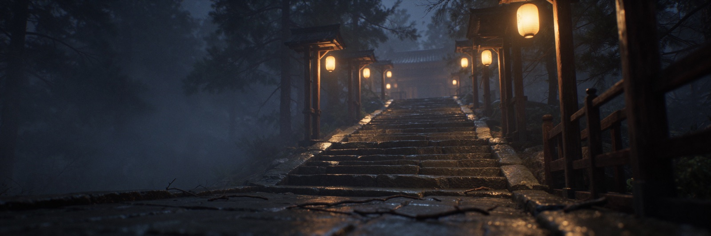
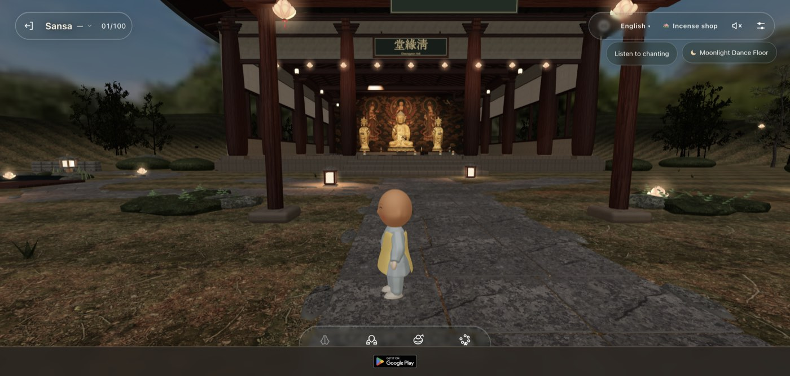

# The AI temple everyone talked about is now open source

[中文](README.md) · [English](README.en.md) · [日本語](README.ja.md) · [한국어](README.ko.md)



Sansa (산사) is an online Buddhist temple that went viral in Korea — over a million visitors in its first ten-plus days. I rebuilt it as **Still Temple**, and the front end is now open.

- Live: <https://stilltemple.app/en>
- This repo: front end + a single Go server. **No database, no accounts, no analytics.**
- Production: <https://stilltemple.app>, running an enhanced build of this code.



## What it is

A 3D mountain temple you can walk into from a browser.

No sign-up. You get a dharma name at the door. You can walk the stone steps, bow in front of the hall, strike a wooden fish, turn 108 prayer beads, offer incense, listen to chanting. Other people are there, but nobody can message you — **no chat, no DMs, no following**.

It isn't selling online worship. It sells three minutes where you don't have to do anything.

The person who built this has been writing code for more than ten years, and is a lay Buddhist.

## Why open source

The value here isn't the code, it's the space.

The front end is complete: six languages, the 3D scene, room sharding, audio mixing, touch gestures. The backend does one thing — count people per room. So it ships as a single Go binary: heartbeats in memory, 90-second expiry, no database.

What the production build adds — replaced assets, analytics, accounts, apps, monitoring — is not in this repo.

## Run it

Go 1.21+.

```bash
git clone https://github.com/xxjrq/still-temple.git
cd still-temple
go run .
```

Open <http://127.0.0.1:8099/en>. ` / ` is Korean; `/zh` `/ja` `/es` `/fr` are the rest.

Front end only, no backend:

```bash
cd web && python3 -m http.server 8080
```

Room counts fall back to a local simulation when `/api/rooms` is missing.

## API

| Method | Path | Notes |
| --- | --- | --- |
| GET | `/api/rooms` | rooms and counts, `maru-1 … maru-100` |
| POST | `/api/presence` | heartbeat `{id, room}` |
| DELETE | `/api/presence` | leave `{id}` |
| GET | `/healthz` | `{"ok":true}` |

## Layout

```
.
├── main.go            # entry: static hosting + routes
├── rooms.go           # 100 room shards
├── site.go            # static files, cache headers, language paths
├── main_test.go
├── web/               # six-language pages + 3D scene + audio
└── docs/screenshot.jpg
```

## Open source vs production

| | This repo | stilltemple.app |
| --- | --- | --- |
| Pages and 3D scene | yes | yes |
| Rooms and counts | single process, memory | sharded, heartbeats, monitoring |
| Assets | original licensed assets | gradually replaced with our own |
| Analytics | none | dwell time, room switches, languages |
| Accounts | none | anonymous dharma name only |
| Apps | none | iOS / Android |
| Database | none | anonymous sessions only |

## Assets and attribution

The models and audio are not ours; they are used under the original site's public licences, with credit kept:

- **Buddha models** — after the gilt-bronze Buddha and bodhisattva (Deoksu 2116) at the National Museum of Korea, under **Korean Open Government License Type 1** (commercial use and modification allowed, attribution required).
- **Wooden fish / chanting audio** — Kim Yong-bae / Gongu Madang / **CC BY 4.0**, excerpted and level-adjusted.
- **Front-end code** — a study mirror of the site's public pages; copyright remains with the original author. This repo only rebrands and adapts it.
- **Font (SansaQuietUI)** — shipped with the original site; licence unpublished, removed on request.

Our own work (Go server, build, docs) is MIT. See [NOTICE.md](NOTICE.md).

## What we don't do

No blessing-for-payment, no donations, no phone numbers, no location, no leaderboards, no streak nudges.

## Contact

- WeChat: `haohaoxuexibbb` (please note "Still Temple")
- QQ: `2265436738`
- Add me on WeChat and I'll put you in the group: online spaces, indie dev, asset pipelines. No promos, no streaks.

## Roadmap

- [ ] Replace all assets with our own models (generated, then cleaned in Blender)
- [ ] Quality tiers for mobile GPUs
- [ ] Offline-capable PWA cache
- [ ] Room density map (density only, never individuals)
- [x] Six languages, room shards, heartbeat counts
