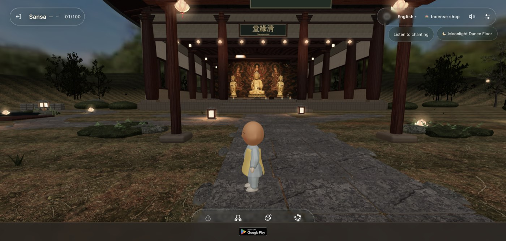

# 韓国で話題になった「AI 寺院」をオープンソースにしました

[中文](README.md) · [English](README.en.md) · [日本語](README.ja.md) · [한국어](README.ko.md)


韓国で 100 万人以上が訪れたオンライン寺院 **Sansa（산사）** を、**Still Temple（静寺）** として作り直し、フロントエンド一式を公開しました。

- 公開サイト：<https://stilltemple.app/ja>
- このリポジトリ：フロントエンド + 単一バイナリの Go サーバー。**データベースなし、アカウントなし、計測なし**
- 正式版：<https://stilltemple.app>（このコードを拡張した版）




## これは何か

ブラウザから入れる 3D のお寺です。

登録はありません。入口で法名が与えられます。石段を歩き、堂の前で合掌し、木魚をたたき、108 の数珠を繰り、お香を供え、読経を聴けます。人はいますが、**誰もあなたにメッセージを送れません**——チャットも DM もフォローもありません。

売っているのは「オンライン礼拝」ではなく、**何もしないでいられる 3 分間**です。

作った人は、10 年以上コードを書いてきたプログラマーで、在家の仏教徒でもあります。

## なぜ公開するのか

価値はコードではなく、**その空間**にあります。

フロントエンドは完全です：6 言語、3D シーン、ルーム分割、音声ミックス、タッチ操作。バックエンドの仕事は 1 つだけ——ルームごとの人数を数えること。だからメモリ内のハートビート、90 秒で失効、データベースなしの単一バイナリです。

正式版が足しているもの（素材の差し替え、計測、アカウント、アプリ、監視）は、このリポジトリには含まれません。

## 動かす

Go 1.21 以上。

```bash
git clone https://github.com/xxjrq/still-temple.git
cd still-temple
go run .
```

<http://127.0.0.1:8099/ja> を開いてください。`/` は韓国語、`/zh` `/en` `/es` `/fr` はその他の言語です。

フロントエンドのみ：

```bash
cd web && python3 -m http.server 8080
```

`/api/rooms` がない場合、人数はローカル模拟に切り替わります。

## API

| メソッド | パス | 内容 |
| --- | --- | --- |
| GET | `/api/rooms` | ルーム一覧と人数（`maru-1 … maru-100`） |
| POST | `/api/presence` | ハートビート `{id, room}` |
| DELETE | `/api/presence` | 退出 `{id}` |
| GET | `/healthz` | `{"ok":true}` |

## 素材とクレジット

モデルと音声は自作ではなく、元サイトが公開ライセンスで使っているものです。クレジットを保持しています。

- **仏像モデル** — 韓国国立中央博物館蔵「金銅仏坐像・菩薩立像（徳寿 2116）」を原型とし、**韓国公共資料第 1 類（KOGL Type 1）** で利用。商用利用・改変可、出典表示が必要。
- **木魚・読経の音声** — 金容培（김용배）/ 共有マダン / **CC BY 4.0**。一部抜粋と音量調整を行っています。
- **フロントエンドのコード** — 元サイト公開ページの学習用ミラー。著作権は原作者に帰属します。本リポジトリはブランド名の変更と調整のみを行っています。
- **フォント（SansaQuietUI）** — 元サイトに同梱。ライセンスは未公開で、権利者の申し出があれば削除します。

本リポジトリの自作部分（Go サーバー、ビルド、ドキュメント）は MIT です。詳細は [NOTICE.md](NOTICE.md)。

## やらないこと

有料の祈祷・開光・消災・寄付の受付、電話番号・位置情報の収集、ランキング、連続ログインの促し。いずれも行いません。

## 連絡先

- WeChat: `haohaoxuexibbb`（「Still Temple」と一言添えてください）
- QQ: `2265436738`
- WeChat を追加するとグループに招待します。オンライン空間、個人開発、素材の作り方の話。宣伝も連続ログインの促しもありません。
- Telegram: https://t.me/stilltemple

## ロードマップ

- [ ] 全素材を自作モデルに差し替え（生成 → Blender で調整）
- [ ] モバイル向け画質ティア
- [ ] オフライン対応の PWA キャッシュ
- [ ] ルーム密度マップ（密度のみ、個人は表示しない）
- [x] 6 言語、ルーム分割、ハートビート人数
