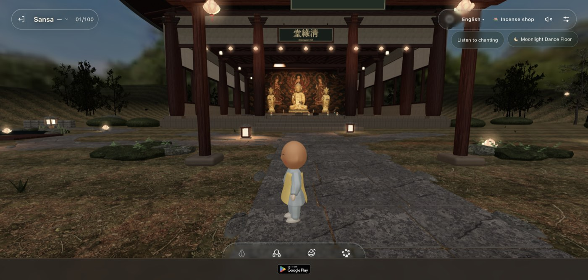

# 한국에서 화제가 된 'AI 사찰'을 오픈소스로 공개했습니다

[中文](README.md) · [English](README.en.md) · [日本語](README.ja.md) · [한국어](README.ko.md)


한국에서 100만 명 넘게 찾아온 온라인 사찰 **산사(Sansa)** 를 **정사(Still Temple)** 로 다시 만들고, 프런트엔드 전체를 공개했습니다.

- 라이브: <https://stilltemple.app>
- 이 저장소: 프런트엔드 + 단일 Go 서버. **데이터베이스 없음, 계정 없음, 분석 도구 없음**
- 정식 버전: <https://stilltemple.app> (이 코드를 확장한 버전)




## 무엇인가

브라우저로 걸어 들어가는 3D 산사입니다.

가입이 없습니다. 들어가면 법명을 하나 받습니다. 돌계단을 걷고, 법당 앞에서 합장하고, 목탁을 두드리고, 108 염주를 돌리고, 향을 올리고, 독경을 들을 수 있습니다. 사람들은 있지만 **누구도 당신에게 메시지를 보낼 수 없습니다** — 채팅도, DM도, 팔로우도 없습니다.

파는 것은 '온라인 예불'이 아니라, **아무것도 하지 않고 있을 수 있는 3분**입니다.

만든 사람은 10년 넘게 코드를 써 온 프로그래머이자, 재가 불자입니다.

## 왜 오픈소스인가

가치는 코드가 아니라 **그 공간**에 있습니다.

프런트엔드는 완전합니다: 6개 언어, 3D 장면, 방 샤딩, 사운드 믹싱, 터치 제스처. 백엔드가 하는 일은 하나입니다 — 방마다 인원을 세는 것. 그래서 메모리 하트비트, 90초 만료, 데이터베이스 없는 단일 바이너리입니다.

정식 버전이 더한 것들(교체된 에셋, 계측, 계정, 앱, 모니터링)은 이 저장소에 없습니다.

## 실행

Go 1.21 이상.

```bash
git clone https://github.com/xxjrq/still-temple.git
cd still-temple
go run .
```

<http://127.0.0.1:8099> 를 엽니다. `/`는 한국어, `/zh` `/ja` `/en` `/es` `/fr`은 나머지 언어입니다.

프런트엔드만:

```bash
cd web && python3 -m http.server 8080
```

`/api/rooms` 가 없으면 인원 수는 로컬 시뮬레이션으로 떨어집니다.

## API

| 메서드 | 경로 | 설명 |
| --- | --- | --- |
| GET | `/api/rooms` | 방 목록과 인원 (`maru-1 … maru-100`) |
| POST | `/api/presence` | 하트비트 `{id, room}` |
| DELETE | `/api/presence` | 퇴장 `{id}` |
| GET | `/healthz` | `{"ok":true}` |

## 에셋과 출처

모델과 소리는 직접 만든 것이 아니라, 원 사이트가 공개 라이선스로 사용한 자료입니다. 출처 표시를 유지합니다.

- **불상 모델** — 국립중앙박물관 소장 「금동불좌상·금동보살입상(덕수 2116)」을 원형으로, **공공누리 제1유형(KOGL Type 1)** 으로 사용. 상업 이용·변경 가능, 출처 표시 필요.
- **목탁·염불 음원** — 김용배 / 공유마당 / **CC BY 4.0**. 일부 구간 추출과 음량 조정을 했습니다.
- **프런트엔드 코드** — 원 사이트 공개 페이지의 학습용 미러. 저작권은 원작자에게 있습니다. 이 저장소는 브랜드 교체와 조정만 했습니다.
- **폰트(SansaQuietUI)** — 원 사이트에 포함된 폰트. 라이선스가 공개되지 않았으며, 권리자의 요청이 있으면 제거합니다.

직접 만든 부분(Go 서버, 빌드, 문서)은 MIT입니다. 자세한 내용은 [NOTICE.md](NOTICE.md).

## 하지 않는 것

유료 기도·개광·소재·기부 접수, 전화번호·위치 수집, 순위표, 연속 출석 유도. 모두 하지 않습니다.

## 연락

- WeChat: `haohaoxuexibbb` ("Still Temple" 남겨 주세요)
- QQ: `2265436738`
- WeChat 추가하면 그룹에 초대합니다. 온라인 공간, 1인 개발, 에셋 제작 이야기. 광고도, 출석 독려도 없습니다.
- Telegram: https://t.me/stilltemple

## 로드맵

- [ ] 모든 에셋을 직접 만든 모델로 교체 (생성 → Blender 보정)
- [ ] 모바일 화질 단계
- [ ] 오프라인 PWA 캐시
- [ ] 방 밀도 지도 (밀도만, 개인은 표시하지 않음)
- [x] 6개 언어, 방 샤딩, 하트비트 인원
