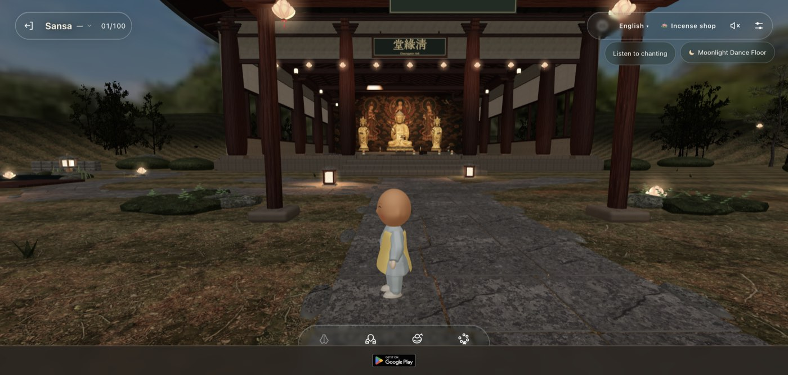

# 很火的 AI 寺庙，开源了

[中文](README.md) · [English](README.en.md) · [日本語](README.ja.md) · [한국어](README.ko.md)


韩国那座上线的「AI 线上寺庙」Sansa（산사），十几天涌进上百万人。我把它复刻下来，改名叫 **静寺 / Still Temple**，现在把**前端整套开源**。

- 在线体验：<https://stilltemple.app/zh>
- 开源版：就是本仓库，纯前端 + 一个 Go 静态服务，**没有数据库，没有账号，没有埋点**
- 正式版：<https://stilltemple.app>，有真实用户，跑在上面这份代码的增强版上



## 这是什么

一座能在浏览器里走进去的 3D 山寺。

进去不用注册，会拿到一个法名。可以沿着石阶走、在佛堂前合掌、敲木鱼、拨 108 颗念珠、上香、听诵经。里面有别人，但没人能给你发消息——**没有聊天、没有私信、没有关注**。

它解决的不是「线上礼佛」，是「有没有一个地方，可以什么都不干地待三分钟」。

做这个的人，写了十多年程序，也是一位居士。

## 为什么开源

因为这个东西的价值不在代码，在**那个空间**。

- 前端是完整的：六个语言、3D 场景、房间分片、声音混合、移动端手势，全在这里
- 后端只有一件正事：把在线人数按房间数准。所以只给了个单文件 Go 服务，内存里记心跳，90 秒过期，没有数据库
- 正式版多出来的东西（素材、埋点、账号、App、监控），不在这个仓库里

## 跑起来

需要 Go 1.21+。

```bash
git clone https://github.com/xxjrq/still-temple.git
cd still-temple
go run .
```

打开 <http://127.0.0.1:8099/zh>（`/` 是韩文，`/en` `/ja` `/es` `/fr` 是其余语言）。

只想看前端，不需要后端：

```bash
cd web && python3 -m http.server 8080
```

房间人数会退回本地模拟（`/api/rooms` 404 时前端自动降级）。

### 接口

| 方法 | 路径 | 说明 |
| --- | --- | --- |
| GET | `/api/rooms` | 房间列表与人数，`maru-1 … maru-100` |
| POST | `/api/presence` | 心跳，`{id, room}` |
| DELETE | `/api/presence` | 离场，`{id}` |
| GET | `/healthz` | `{"ok":true}` |

## 目录

```
.
├── main.go            # 入口：静态托管 + 路由
├── rooms.go           # 100 个房间分片
├── site.go            # 静态文件、缓存头、语言路径
├── main_test.go
├── web/               # 前端（六语言页面 + 3D 场景 + 音频）
└── docs/screenshot.jpg
```

## 开源版 vs 正式版

| | 开源版（本仓库） | 正式版 stilltemple.app |
| --- | --- | --- |
| 页面与 3D 场景 | 有 | 有 |
| 房间与人数 | 单进程内存 | 多分片 + 心跳 + 监控 |
| 素材 | 沿用原站授权素材 | 逐步替换为自制模型与贴图 |
| 埋点 | 无 | 停留时长、切房、语言分布 |
| 账号 | 无 | 匿名法名（不做社交） |
| App | 无 | iOS / Android 可上架 |
| 数据库 | 无 | 仅存匿名会话 |

## 素材与授权（重要）

这个仓库里的模型和声音不是我们做的，是原站按公开许可使用的素材，这里沿用并保留署名：

- **佛像模型**：以韩国国立中央博物馆藏「鎏金铜佛坐像·菩萨立像（德寿2116）」为原型，依 **韩国公共资料第 1 类（KOGL Type 1）** 使用——可商用、可修改，须署名。两侧胁侍的姿态与冠饰为原作的现代诠释。
- **木鱼、念诵音频**：김용배 / 공유마당 / **CC BY 4.0**，含片段截取与音量调整。
- **前端代码**：来自原站公开页面的学习性镜像，版权归原作者。本仓库只做品牌替换与适配，不声称原创。
- **字体（SansaQuietUI）**：随原站分发，若权利人提出异议会立即移除。

我们的原创部分（Go 服务、构建与部署、文档）用 MIT。详见 [NOTICE.md](NOTICE.md)。

如果任何权利人认为这里的使用超出了许可范围，请开 issue，我们会在 48 小时内处理。

## 我们不做什么

- 不做祈福、开光、消灾、超度，也不接募捐
- 不收集手机号、位置、通讯录
- 不做排行榜、不做连续签到、不诱导分享
- 不把「在线人数」做成运营指标对外宣传

## Roadmap

- [ ] 素材全量替换为自制模型（meshy 生成 + Blender 修形）
- [ ] 移动端画质分档（低端机降到 30fps）
- [ ] 离线可用的 PWA 缓存
- [ ] 房间热力图（不显示具体人，只显示密度）
- [x] 六语言、房间分片、心跳人数

## 交流

- 微信：`haohaoxuexibbb`（加时备注「静寺」）
- QQ：`2265436738`
- Telegram：https://t.me/stilltemple （频道，更新与进度都发这里）
- 加了微信我拉你进群：聊线上空间、独立开发、素材怎么换。不推销，不打卡。

## 许可

代码 MIT，素材按其原始许可（KOGL-1 / CC BY 4.0）。引用请保留 [NOTICE.md](NOTICE.md)。
